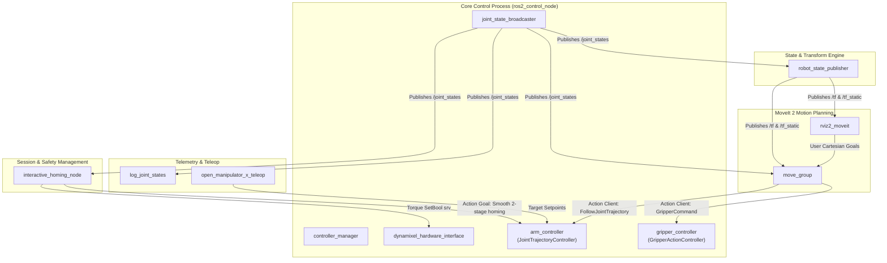

# OpenMANIPULATOR-X: Complete Robotic System Architecture & Technical Manual

**Author:** Robotics Engineering & Autonomous Systems Lecture Series  
**Target Hardware:** ROBOTIS OpenMANIPULATOR-X (RM-X52-TNM)  
**Target Framework:** ROS 2 (Jazzy/Humble) + ros2_control + MoveIt 2  

---

## Table of Contents
1. [Introduction & Pedagogical Philosophy](#1-introduction--pedagogical-philosophy)
2. [Fundamental Concepts & Robotics Terminology](#2-fundamental-concepts--robotics-terminology)
   - [2.1 Kinematic Chains: Links, Joints, and Degrees of Freedom](#21-kinematic-chains-links-joints-and-degrees-of-freedom)
   - [2.2 Forward vs. Inverse Kinematics (FK & IK)](#22-forward-vs-inverse-kinematics-fk--ik)
   - [2.3 URDF (Unified Robot Description Format)](#23-urdf-unified-robot-description-format)
   - [2.4 Xacro: Programmable URDF Macros](#24-xacro-programmable-urdf-macros)
   - [2.5 SRDF: Semantic Robot Description Format](#25-srdf-semantic-robot-description-format)
   - [2.6 TF2: Coordinate Frame Transformations](#26-tf2-coordinate-frame-transformations)
   - [2.7 ros2_control: Hardware-Software Decoupling](#27-ros2_control-hardware-software-decoupling)
   - [2.8 MoveIt 2 & OMPL: Motion Planning Ecosystem](#28-moveit-2--ompl-motion-planning-ecosystem)
3. [The 5-Layer Architectural Hierarchy](#3-the-5-layer-architectural-hierarchy)
4. [Exhaustive Breakdown of Runtime Nodes](#4-exhaustive-breakdown-of-runtime-nodes)
5. [The Lifecycle of a Motion Command: From Coordinate to Stator Coil](#5-the-lifecycle-of-a-motion-command-from-coordinate-to-stator-coil)
6. [Physics, Dynamics & Fail-Safes: The "Side" Branch Innovations](#6-physics-dynamics--fail-safes-the-side-branch-innovations)
7. [System Topics, Services, and Actions Reference](#7-system-topics-services-and-actions-reference)

---

## 1. Introduction & Pedagogical Philosophy

To control a robotic manipulator, software cannot simply send an instruction such as *"move gripper to position (X, Y, Z)"*. A physical robot is a coupled, non-linear dynamical system composed of rigid metal links, gear trains, brushless or coreless DC motors, magnetic encoders, and serial communication buses. 

Bridging the gap between a high-level intent (e.g. an AI policy or a user dragging a marker) and physical motor motion requires solving three fundamental problems:
1. **Geometric & Kinematic Problem**: Which exact joint angles align the gripper with the target 3D pose, and how do we travel there without hitting obstacles or exceeding mechanical limits?
2. **Trajectory & Interpolation Problem**: How do we generate continuous, smooth curves for positions, velocities, and accelerations over time so the motors do not exceed torque limits or vibrate destructively?
3. **Real-Time Control & Hardware Interface Problem**: How do we deterministically dispatch setpoints to multiple actuators across a half-duplex serial bus at 100 Hz while reading back high-fidelity encoder telemetry?

The OpenMANIPULATOR-X software repository solves this by layering specialized technologies. This document explores each component in depth.

---

## 2. Fundamental Concepts & Robotics Terminology

### 2.1 Kinematic Chains: Links, Joints, and Degrees of Freedom
* **Link**: A rigid body that maintains fixed geometric and inertial properties. In the OpenMANIPULATOR-X, these are the molded carbon/plastic structures: `link1` (base), `link2` (shoulder), `link3` (upper arm), `link4` (forearm), `link5` (wrist), and the gripper fingers.
* **Joint**: A mechanical constraint connecting two links that allows relative motion.
  * **Revolute Joint**: Permits single-axis rotational motion within bounded limits ($\theta_{min} \le \theta \le \theta_{max}$, measured in radians). Joint 1 through 4 are revolute.
  * **Prismatic Joint**: Permits linear sliding motion along an axis. The left gripper finger is prismatic.
  * **Mimic Joint**: A dependent joint whose value is automatically computed as a linear function of another joint ($q_{mimic} = m \cdot q_{parent} + o$). The right gripper finger mimics the left finger with a multiplier of $1.0$ and offset $0.0$.
  * **Fixed Joint**: Rigidly fixes two frames together with zero motion (e.g., `end_effector_joint` attaching `end_effector_link` to `link5`).
* **Degrees of Freedom (DoF)**: The number of independent parameters that define the robot's configuration. The OpenMANIPULATOR-X arm has **4 DoF** for arm articulation plus **1 DoF** for gripping. Because full 3D spatial positioning and orientation requires 6 DoF ($X, Y, Z, \text{Roll}, \text{Pitch}, \text{Yaw}$), a 4-DoF arm is **kinematically under-actuated**; it cannot achieve arbitrary orientations at every spatial coordinate $(x,y,z)$.

### 2.2 Forward vs. Inverse Kinematics (FK & IK)
* **Forward Kinematics (FK)**: Given known joint angles $\mathbf{q} = [\theta_1, \theta_2, \theta_3, \theta_4]^T$, compute the Cartesian pose $(\mathbf{p}, \mathbf{R})$ of the end-effector in the base frame:
  $$\mathbf{T}_{base}^{tool}(\mathbf{q}) = \mathbf{T}_0^1(\theta_1) \cdot \mathbf{T}_1^2(\theta_2) \cdot \mathbf{T}_2^3(\theta_3) \cdot \mathbf{T}_3^4(\theta_4) \cdot \mathbf{T}_4^{tool}$$
  FK is single-valued and computationally trivial.
* **Inverse Kinematics (IK)**: Given a desired 6D Cartesian pose $(\mathbf{p}_{des}, \mathbf{R}_{des})$, find the joint angles $\mathbf{q}$ that satisfy:
  $$\mathbf{T}_{base}^{tool}(\mathbf{q}) = \begin{bmatrix} \mathbf{R}_{des} & \mathbf{p}_{des} \\ \mathbf{0} & 1 \end{bmatrix}$$
  IK is highly non-linear, may have multiple solutions, or may have no solution if the target is outside the workspace or requires an unobtainable orientation. MoveIt uses numerical kinematic solvers (such as KDL — Kinematics and Dynamics Library) to iteratively solve IK.

### 2.3 URDF (Unified Robot Description Format)
URDF is an XML specification standardized in ROS. It defines:
1. **Kinematic Topology**: The parent-child tree linking all bodies.
2. **Visual Representation**: 3D mesh files (`.stl` / `.dae`), colors, and scaling for RViz rendering.
3. **Collision Representation**: Simplified geometric shapes or convex meshes used by collision detection engines to evaluate proximity and contact without computing high-polygon meshes.
4. **Inertial Properties**: Mass ($m$), Center of Mass ($x,y,z$), and the $3 \times 3$ symmetric Inertia Tensor Matrix ($\mathbf{I}_{xx}, \mathbf{I}_{yy}, \mathbf{I}_{zz}, \mathbf{I}_{xy}, \mathbf{I}_{xz}, \mathbf{I}_{yz}$). These are required for gravity compensation and dynamic simulation.

### 2.4 Xacro: Programmable URDF Macros
Raw URDF files suffer from verbosity, hardcoded values, and repetition. **Xacro (XML Macros)** is a macro language executed prior to launch. It adds:
* Variables (`<xacro:property name="pi" value="3.1415926"/>`).
* Mathematical expressions (`${pi / 2.0}`).
* Modular inclusion (`<xacro:include filename="..."/>`).
* Conditional logic (`<xacro:if value="$(arg use_sim)">`).
* Parameterized definitions for joints, links, and transmission blocks.

### 2.5 SRDF: Semantic Robot Description Format
While URDF describes the *physical robot*, it lacks operational and semantic context. **SRDF** provides the semantic configuration required by MoveIt 2:
1. **Planning Groups**: Logical groupings of joints and links. In our robot:
   * Group `"arm"`: `joint1`, `joint2`, `joint3`, `joint4`.
   * Group `"gripper"`: `gripper_left_joint`.
2. **Named Joint States**: Pre-programmed reference configurations (e.g., `<group_state name="home">`).
3. **End-Effector Definitions**: Identifies which group acts as a tool on which parent link.
4. **Collision Disable Pairs (`<disable_collisions link1="..." link2="..."/>`)**: An $N$-link robot requires $\frac{N(N-1)}{2}$ collision checks per simulation tick. Links that physically touch by design (like adjacent links connected by a joint) would constantly register self-collisions. The SRDF lists verified safe pairs, pruning redundant collision checks and improving planning performance.

### 2.6 TF2: Coordinate Frame Transformations
In robotics, every sensor, joint, link, and camera has its own local Cartesian coordinate system. **TF2** is the ROS 2 transform library that maintains a dynamically updated directed tree of coordinate frames.
* `robot_state_publisher` listens to joint positions $\mathbf{q}(t)$ and computes the relative transforms between adjacent frames using the URDF.
* It continuously broadcasts these transforms to `/tf` (dynamic, time-varying transforms) and `/tf_static` (fixed geometric offsets).
* Any node can ask TF2: *"Where is the red cup in camera frame relative to the robot base frame right now?"* and obtain the transformation matrix $\mathbf{T}_{base}^{camera}$.

### 2.7 ros2_control: Hardware-Software Decoupling
Historically in robotics, writing a new control algorithm (e.g. impedance control) required writing proprietary serial drivers for the specific motors used. `ros2_control` solves this via strict separation:
* **Controller Manager (`controller_manager`)**: Hosts and schedules controllers.
* **Controllers**: Algorithmic plugins (e.g. `JointTrajectoryController`, `JointStateBroadcaster`, `GripperActionController`).
* **Hardware Interface (`hardware_interface::SystemInterface`)**: A C++ plugin that communicates directly with actuators or simulators. It exposes **Command Interfaces** (writable memory slots, e.g., position, velocity, effort) and **State Interfaces** (readable memory slots from sensors).
* **The Real-Time Loop**: Runs deterministically (e.g., 100 Hz). In each cycle:
  $$\text{Hardware Read} \longrightarrow \text{Controller Update} \longrightarrow \text{Hardware Write}$$

### 2.8 MoveIt 2 & OMPL: Motion Planning Ecosystem
MoveIt 2 is the primary manipulation planning framework in ROS 2. It does not control motors directly; it coordinates the planning workflow:
* **Planning Scene Monitor**: Maintains the world state, including the robot's current pose and surrounding collision objects.
* **OMPL (Open Motion Planning Library)**: Provides sampling-based path-planning algorithms like **RRT-Connect** (Rapidly-exploring Random Trees) and **BKPIECE**. It searches high-dimensional joint space to find an obstacle-free geometric path from $\mathbf{q}_{start}$ to $\mathbf{q}_{goal}$.
* **Time Parameterization (TOTG)**: Converts a geometric path (a sequence of waypoints) into a time-parameterized trajectory $\mathbf{q}(t), \dot{\mathbf{q}}(t), \ddot{\mathbf{q}}(t)$ that respects the velocity and acceleration limits in `joint_limits.yaml`.

---

## 3. The 5-Layer Architectural Hierarchy

```
+=============================================================================+
|                    LAYER 5: HIGH-LEVEL APPLICATION & PLANNING               |
|   • MoveIt 2 (move_group node)                                              |
|   • MoveGroupInterface (C++ / Python APIs, VLA Policies, Task Autonomy)     |
|   • Interactive Visualizer (RViz 2 interactive 3D marker)                   |
+======================================┬======================================+
                                       │ Action Goal: FollowJointTrajectory
                                       ▼
+=============================================================================+
|                    LAYER 4: ROS 2 CONTROL FRAMEWORK                         |
|   • controller_manager (ros2_control_node running at 100 Hz)                |
|   • arm_controller (JointTrajectoryController: cubic/quintic splines)       |
|   • gripper_controller (GripperActionController)                            |
|   • joint_state_broadcaster (Publishes sensor_msgs/JointState)              |
+======================================┬======================================+
                                       │ Real-time read() & write() buffers
                                       ▼
+=============================================================================+
|                    LAYER 3: HARDWARE ABSTRACTION LAYER                      |
|   • dynamixel_hardware_interface (DynamixelHardware SystemInterface Plugin) |
|   • dynamixel_interfaces (DynamixelState.msg, SetDataToDxl.srv)             |
|   • Radian <-> Encoder Tick Conversion (4096 ticks = 2*pi rad)              |
+======================================┬======================================+
                                       │ GroupSyncWrite & GroupSyncRead packets
                                       ▼
+=============================================================================+
|                    LAYER 2: LOW-LEVEL SERIAL BUS PROTOCOL                   |
|   • DynamixelSDK (Protocol 2.0 packet framing, CRC16 checksums)             |
|   • PortHandlerLinux (1,000,000 bps serial port timing & latency timers)    |
+======================================┬======================================+
                                       │ USB Serial (/dev/ttyUSB0)
                                       ▼
+=============================================================================+
|                    LAYER 1: PHYSICAL ROBOT & ACTUATORS                      |
|   • U2D2 Converter (USB to Half-Duplex RS-485 / TTL)                        |
|   • Joint 1-4: Dynamixel XM430-W350-T Actuators                             |
|   • Gripper: Dynamixel XC430 / XL430 Actuator                               |
+=============================================================================+
```

---

## 4. Exhaustive Breakdown of Runtime Nodes

When the complete system is launched (via `open_manipulator_x_interactive.launch.py` and `open_manipulator_x_moveit.launch.py`), the following nodes execute:



### 1. `ros2_control_node` (Package: `controller_manager`)
* **Type**: Long-running core executable.
* **Execution Rate**: Exactly **100 Hz** (10 ms period), defined in `hardware_controller_manager.yaml`.
* **Purpose**: Hosts the controller manager and loads the `DynamixelHardware` plugin. It maintains internal real-time memory buffers for command interfaces (`position`) and state interfaces (`position`, `velocity`, `effort`).
* **Loop Mechanics**:
  1. Calls `hardware_interface->read()`: Instructs DynamixelSDK to read all actuator positions via serial.
  2. Executes active controller updates: `arm_controller` interpolates its active trajectory to compute the target angle for the current 10 ms interval.
  3. Calls `hardware_interface->write()`: Instructs DynamixelSDK to send target positions to the actuators.

### 2. `robot_state_publisher` (Package: `robot_state_publisher`)
* **Type**: Long-running core executable.
* **Purpose**: Subscribes to `/joint_states` and reads the robot model from the `robot_description` parameter (URDF). It evaluates forward kinematics and broadcasts the full 3D transform tree to `/tf` and `/tf_static`.

### 3. `interactive_homing_node` (Package: `custom_package`)
* **Type**: Interactive session manager.
* **Purpose**: Replaces the basic hardcoded homing script. 
* **Capabilities**:
  * **Interactive Startup**: Unlocks torque at launch so the arm can be hand-positioned (Option 1) or smoothly moves to the calibrated default home via a 2-stage trajectory (Option 2).
  * **Zero-Jerk Hand-off**: When torque is locked after manual positioning, it overwrites `arm_controller`'s setpoint to match the current physical pose, preventing motor snapback.
  * **Safe Exit (`z` key)**: Listens on `/dev/tty` for keypress `z`. On exit, it drives the arm to the minimum-stress resting position before disabling torque, preventing arm collapse.

### 4. `move_group` (Package: `moveit_ros_move_group`)
* **Type**: MoveIt 2 master motion planning server.
* **Purpose**: The central node for manipulation planning. It hosts action servers for Cartesian and joint goals, maintains the dynamic Planning Scene, queries kinematic plugins (KDL), runs collision checking (FCL), and executes path planning (OMPL). When a plan is accepted, it manages trajectory dispatch to `ros2_control_node`.

### 5. `rviz2_moveit` (Package: `rviz2`)
* **Type**: 3D Visualization and GUI interface.
* **Purpose**: Renders the robot's physical visual model, collision meshes, TF frames, and live joint states. Provides an interactive 6D marker on the end-effector allowing users to drag the arm to target poses in 3D space and trigger "Plan & Execute".

### 6. `log_joint_states` (Package: `custom_package`)
* **Type**: Diagnostic telemetry node.
* **Purpose**: Subscribes to `/joint_states` and logs formatted joint angles in both Radians and Degrees at a throttled, human-readable frequency (default: 5 Hz).

---

## 5. The Lifecycle of a Motion Command: From Coordinate to Stator Coil

To understand how high-level software translates into physical actuation, consider the complete sequence when a user commands the end-effector to move from its current position to $(X=0.20\text{ m}, Y=0.00\text{ m}, Z=0.15\text{ m})$:

```
[User / MoveGroupInterface / RViz]
               │  1. setPoseTarget(x=0.20, y=0.00, z=0.15)
               ▼
      [move_group Node]
               │  2. Inverse Kinematics (KDL) -> Solves target angles (q1, q2, q3, q4)
               │  3. Collision Checking (FCL) -> Verifies collision-free path
               │  4. Motion Planning (OMPL)   -> RRT-Connect generates path waypoints
               │  5. Time Parameterization     -> TOTG assigns timestamps & velocities
               ▼
[MoveItSimpleControllerManager]
               │  6. Sends Action Goal: FollowJointTrajectory.action
               ▼
      [arm_controller] (Inside ros2_control_node at 100 Hz)
               │  7. Action Server accepts goal
               │  8. Every 10 ms: Evaluates quintic spline to get current target radians
               │  9. Pushes target radians into joint command interface buffers
               ▼
[dynamixel_hardware_interface]
               │ 10. write() called by Controller Manager
               │ 11. Converts radians to encoder ticks:
               │     Tick = (Radian / (2 * pi)) * 4096
               ▼
       [DynamixelSDK]
               │ 12. GroupSyncWrite: Builds Protocol 2.0 packet:
               │     [0xFF, 0xFF, 0xFD, 0x00, ID, Length, 0x83, Addr_GoalPos, ...]
               │ 13. Computes CRC16 Checksum and transmits over USB serial (1 Mbps)
               ▼
    [U2D2 Serial Adapter]
               │ 14. Transmits TTL/RS-485 balanced voltage pulses across daisy chain bus
               ▼
[Dynamixel XM430 Actuators]
               │ 15. Onboard Cortex-M4 MCU receives packet and verifies CRC
               │ 16. Internal PID loop drives H-Bridge PWM to energize stator coils
               │ 17. Contactless magnetic encoder reads shaft rotation
               ▼
       [Feedback Loop]
               │ 18. DynamixelSDK executes GroupSyncRead at 100 Hz
               │ 19. Hardware interface converts ticks back to radians
               │ 20. joint_state_broadcaster publishes /joint_states
               │ 21. robot_state_publisher updates /tf coordinate tree
               │ 22. move_group updates PlanningScene with live physical pose
```

---

## 6. Physics, Dynamics & Fail-Safes: The "Side" Branch Innovations

The updates in the `side` branch address the mechanical and electrical constraints of the OpenMANIPULATOR-X:

### 1. The Physics of the Joint 2 Overload Error (`0x20`)
The arm uses **Dynamixel XM430-W350-T** actuators with a stall torque of approximately $4.1\text{ N}\cdot\text{m}$ at $12\text{V}$. 
* In a serial link arm, **Joint 2 (shoulder)** supports the cumulative gravitational torque of Link 2, Link 3, Link 4, Link 5, the gripper mechanism, and any payload:
  $$\tau_{gravity} = \sum_{i=2}^{5} m_i \cdot g \cdot r_{cm,i} \cdot \cos(\theta_2)$$
* When the arm accelerates forward in an extended horizontal pose, the dynamic torque combined with gravitational load can exceed the actuator's continuous current threshold.
* The actuator's internal microcontroller detects continuous over-current and asserts an **Overload Hardware Error flag (`0x20`)**, disabling the motor's H-bridge to prevent thermal damage and causing the arm to collapse.

### 2. The 2-Stage Safe Homing Solution
The `side` branch mitigates this by implementing a **2-stage trajectory**:
* **Stage 1**: Lifts Joint 3 (elbow) upward first. This draws the arm's center of mass inward toward the base, reducing the effective lever arm ($r_{cm}$).
* **Stage 2**: Once the moment arm is reduced, Joint 2 rotates to its target angle under significantly reduced gravitational torque.

```
Extended Pose (High Torque):
Base ─── Shoulder ────────────────── Elbow ────────────────── Hand  [HIGH GRAVITY LOAD]

2-Stage Homing Pose (Low Torque):
Base ─── Shoulder ─── Elbow                                         [REDUCED LEVER ARM]
                        │
                        Hand
```

### 3. The Minimum-Stress Exit Routine
* When motor torque is disabled, non-backdrivable worm-gear robots stay in place, but direct-drive and low-gear planetary/spur actuators (like the Dynamixel XM series) are **backdrivable under gravity**.
* Cutting torque in an upright or extended posture causes the arm to drop and strike the mounting surface.
* The minimum-stress exit position (`[0.4633, -1.8190, 1.4972, 0.4019]`) is the measured pose the arm rests in with torque off, so disabling torque there barely drops it. joint2 is held just inside its servo Min Position Limit (the arm itself rests at −1.839). From there the operator either returns to the session home ([1]) or disables torque and quits ([2]), which also shuts down the launch.

---

## 7. System Topics, Services, and Actions Reference

### Core ROS 2 Topics
| Topic Name | Message Type | Publishing Node | Description |
| :--- | :--- | :--- | :--- |
| `/joint_states` | `sensor_msgs/msg/JointState` | `joint_state_broadcaster` | High-frequency telemetry (joint angles, velocities, and currents). |
| `/tf` | `tf2_msgs/msg/TFMessage` | `robot_state_publisher` | Dynamic coordinate frame transformations across the robot. |
| `/tf_static` | `tf2_msgs/msg/TFMessage` | `robot_state_publisher` | Static offsets between fixed structural robot links. |
| `/dynamixel_hardware_interface/dxl_state` | `dynamixel_interfaces/msg/DynamixelState` | `dynamixel_hardware_interface` | Raw actuator telemetry (voltages, temperatures, error flags). |

### Core ROS 2 Services
| Service Name | Service Type | Server Node | Description |
| :--- | :--- | :--- | :--- |
| `/dynamixel_hardware_interface/set_dxl_torque` | `std_srvs/srv/SetBool` | `dynamixel_hardware_interface` | Enables (`true`) or disables (`false`) motor holding torque. |
| `/dynamixel_hardware_interface/reboot_dxl` | `dynamixel_interfaces/srv/RebootDxl` | `dynamixel_hardware_interface` | Clears hardware error states (e.g. overload `0x20`) by rebooting actuators. |
| `/go_home_and_quit` | `std_srvs/srv/Trigger` | `interactive_homing_node` | Triggers minimum-stress parking trajectory and clean shutdown. |

### Core ROS 2 Actions
| Action Name | Action Type | Server Node | Client Nodes |
| :--- | :--- | :--- | :--- |
| `/arm_controller/follow_joint_trajectory` | `control_msgs/action/FollowJointTrajectory` | `arm_controller` | `move_group`, `interactive_homing_node` |
| `/gripper_controller/gripper_cmd` | `control_msgs/action/GripperCommand` | `gripper_controller` | `move_group` |
