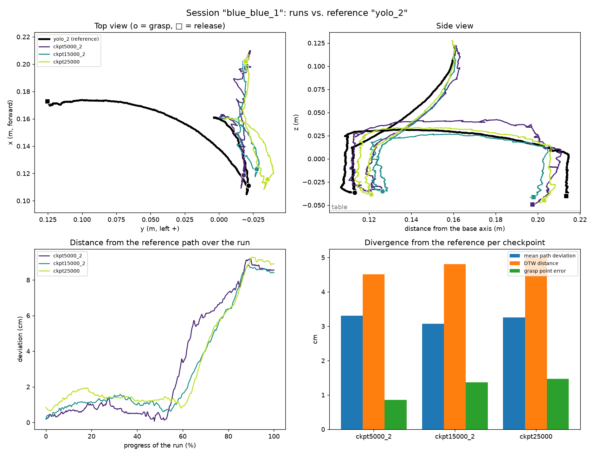

# Policy runs on the real arm (π0.5, two cameras)

One row per run of the fine-tuned policy through `vla_bridge`. Newest last.
- **Recordings + videos:** `/workspace/recordings/policy_runs/<task>/episode_NNNN/` (host: `open_manipulator/docker/workspace/recordings/policy_runs/`,
  git-ignored): the bag (front + wrist cameras, `/joint_states`, `/vla_bridge/action` in the demo action format), `metadata.json` (s/f label)
  and `video.mp4` (front | wrist, from `export_episode_video`). Bridge terminal logs (incl. the `🔎` gripper lines):
  `/workspace/recordings/policy_runs/bridge_<date>_<time>.log`.
- **How to record a run:** see "Recording a run" at the end.
- **Columns:** *Result* = success / partial / failure. *Failure type* = missed grasp, closed on nothing, dropped, wrong place, wrong cube,
  wrong bin, hit table, froze, safety stop, timeout. *Our insight* = yours. *Claude's insight* = filled in by Claude from the logs and video.

## Setup used
| Item | Value |
|---|---|
| Server checkpoint | `pi05_omx_lora_pick_place_2cam/pick_place_2cam_v1/25000` (A30, via `ssh -N -L 4000:localhost:4000`) |
| Training data | `pick_place_2cam`: 60 successful scripted demos, 6 arrangements, front D455 1280×800 + wrist D435 640×480 |
| Bridge | per-joint caps `[0.5, 0.3, 0.6, 0.8]` rad/s, start at READY, 15 Hz |

## Runs
| # | Date, time | Checkpoint | Prompt | Cube start (x, y m) | Bridge settings | Result | Failure type | Recording / video | Our insight | Claude's insight |
|---|---|---|---|---|---|---|---|---|---|---|
| 1 | 2026-11-25 ~21:00 | 25000 | blue cube → red bin | not noted | `min_z` 0.02 (old default) | failure | safety stop | not recorded | | Stopped by `next step goes below min_z=0.02 m` on the first descent: the floor was 7.6 cm above the table (table z = −0.056 m, demos grasp at −0.038). Not a policy failure. |
| 2 | 2026-11-25 ~21:05 | 25000 | blue cube → red bin | not noted | `min_z` −0.05, arm NOT reset to READY | stopped (d) | gripper flipping | not recorded | | Started low near the cube (left there by run 1). Gripper close → open immediately; at that point we suspected a gripper-encoding mismatch, later ruled out. |
| 3 | 2026-11-25 ~21:25 | 25000 | blue cube → red bin | not noted | `min_z` −0.05, `log_gripper`, from READY | stopped (d) after grasp | gripper flipping (5×) | not recorded (bridge log in chat) | | Clean approach from READY (z 0.12 → −0.044). The model plans the close ~7–8 steps ahead in every chunk; the bridge closed at the end of each old chunk and reopened at the next chunk's "0.00 now" → bridge bug, fixed (`GripperHysteresis` with `upcoming`). Once the model said 1.0 everywhere, state 0.70 = cube held, as in the demos. Fingertip went to −0.044 m (demos −0.0425…−0.0347). |
| 4 | 2026-11-25 ~21:30 | 25000 | blue cube → red bin | not noted | as 3 + hysteresis fix | failure | closed on nothing, froze | not recorded (bridge log in chat) | | Flip fixed: one close. But state 0.79 → 0.99 = fingers fully closed, cube slipped or was off-centre; fingertip at −0.045…−0.048 m, i.e. below every demo grasp, fingers touching the table (likely pushed the cube). Afterwards the model kept the gripper closed and hovered at z ≈ 0 for ~1 min: a fully closed gripper never occurs in the training data (failed demos excluded), so it has no idea how to recover. |
| 5 | 2026-11-25 ~21:33 | 25000 | blue cube → red bin | not noted | as 4 | stopped (Ctrl+C) | hesitation | not recorded | | Went down to −0.029, back up to −0.015, down again, then closed at −0.037: hesitation near the cube; stopped right after the close, outcome unknown. |
| 6 | 2026-11-25 ~21:35 | 25000 | blue cube → red bin | not noted | as 4 | stopped (Ctrl+C) before close | hit table | not recorded | | Reached −0.046 m with the close planned 1–3 steps ahead; user stopped it because it was hitting the table. Since then: `min_z` default −0.043 + `min_z_hold` (arm stops at the floor, gripper still closes). |

## Patterns so far (Claude)
- The approach from READY is consistent and smooth; the model descends to roughly the right height and plans the close at the right moment.
- It goes ~0.5–1 cm lower than the demos (−0.044 … −0.048 vs. −0.038 median), so it touches the table and can push the cube. Floor at −0.043 m now.
- It has never seen a missed grasp or a fully closed gripper, so after a miss it freezes instead of retrying: a direct argument for
  training on its own (labelled) attempts, i.e. the self-improvement loop.
- "Wrong place sometimes" (user): to separate a policy problem from out-of-distribution cube positions, note the cube start (x, y) of every
  run from now on; the 8 blue → red bin demos had the cube at (0.118, −0.161), (0.205, −0.205), (0.127, −0.022), (0.100, −0.249),
  (0.137, −0.033), (0.221, −0.169), (0.293, 0.129), (0.162, −0.240).

- **Checkpoints (user's trials, 2026-11-25):** 5000 worked better than 20000 and 25000 → later checkpoints over-fit the 60 episodes
  (loss ≈ 0.002 from ~17k steps). Note the checkpoint in every row from now on.
- **Cube position (user's trials):** pick-and-place works best with the cube near the centre, close to the robot. The demo cube positions are
  spread out (16 of 60 within 10 cm of the centre), so this is the average and easiest position (short reach, near-vertical grasp, both
  cameras see it), not an over-represented one: the policy has the task, not yet precise localisation.
- **Smoothness (user's trials):** less smooth than the scripted min-jerk motion. Likely from chunk replacement (~5 of 10 steps executed,
  then a new chunk; no blending), 30 → 15 Hz action downsampling, and the speed caps. Candidate fix: temporal ensembling of overlapping chunks.

- **Bin instruction not followed (blue_blue_1, 2026-11-25):** all checkpoints grasp the right cube but release it in the green bin
  instead of the blue one; see "Checkpoint divergence" below.

## Recording a run
Inside the container, besides the arm, `zenohd`, cameras and the SSH tunnel:

**T3: recorder** (one session per prompt; each ENTER = one run; saves under `policy_runs/<prompt>/episode_NNNN`):
```bash
ros2 run custom_package record_episodes --ros-args \
  --params-file $(ros2 pkg prefix custom_package)/share/custom_package/config/record_episodes.yaml \
  -p data_dir:=/workspace/recordings/policy_runs -p task:="pick up the blue cube and place it in the red bin" \
  -p action_topic:=/vla_bridge/action -p min_rate_action:=12.0 -p operator:=pi05_2cam_25000 \
  -p grid_positions:=0 -p max_duration:=90.0
```
**T4: bridge**, its output also saved to a log file:
```bash
PYTHONUNBUFFERED=1 ros2 run custom_package vla_bridge --ros-args \
  --params-file $(ros2 pkg prefix custom_package)/share/custom_package/config/vla_bridge.yaml \
  -p server_host:=localhost -p "max_joint_vel_per_joint:=[0.5, 0.3, 0.6, 0.8]" -p log_gripper:=true \
  -p prompt:="pick up the blue cube and place it in the red bin" \
  2>&1 | tee -a /workspace/recordings/policy_runs/bridge_$(date +%F_%H%M).log
```
Per run: place the cube and **write down its position** → T3 ENTER (recording starts) → T4 `e` → watch → T4 `d` → T3 ENTER (stop) →
label `s` / `f` (`d` = discard) → the recorder moves the arm back to READY by itself. Afterwards, videos for all new runs:
```bash
ros2 run custom_package export_episode_video /workspace/recordings/policy_runs
```
Then add the row here (or paste the run number + outcome to Claude, who adds the row and the insight).

## Checkpoint divergence: policy vs. the YOLO pipeline (same command, same cube position)
`trajectory_compare` logs the fingertip path (from `/joint_states`) of each run and compares every checkpoint with the scripted YOLO
run, which is the "correct" trajectory. Output per session in `/workspace/recordings/trajectory_compare/<session>/`:
`divergence.png` (top view, side view, deviation over the run, bars per checkpoint) and `metrics.md` / `metrics.csv`:
mean and max deviation from the reference path, DTW distance, grasp and release point error (cm), duration, RMS jerk (smoothness).

Once: rebuild (`colcon build --symlink-install --packages-select custom_package && source install/setup.bash`). Mark the cube's spot
on the table with tape: **every run of a session starts with the cube there and the arm at READY**.

1. **Reference (YOLO pipeline).** T_rec: `ros2 run custom_package trajectory_compare record --session blue_red_1 --label yolo
   --prompt "pick up the blue cube and place it in the red bin" --cube "0.13 -0.03"` (example: use your session's command) → ENTER. T_demo (camera with depth + detector
   running, i.e. `pick_place_test.launch.py`): `ros2 run custom_package guided_demo --ros-args --params-file
   $(ros2 pkg prefix custom_package)/share/custom_package/config/guided_demo.yaml -p arrangement:=free -p record:=false` → pick the
   blue cube and the red bin. After the release: ENTER in T_rec. Put the cube back on its mark, arm at READY.
2. **Each checkpoint** (5000, then 15000, then 25000). On the A30, serve that checkpoint
   (`--policy.dir=checkpoints/pi05_omx_lora_pick_place_2cam/pick_place_2cam_v1/<N>`); restart the bridge (it loses the connection when
   the server restarts). T_rec: `... record --session blue_red_1 --label ckpt<N> ...` → ENTER; bridge `e`; after the release (or a
   clear failure) bridge `d`, ENTER in T_rec. Cube back on its mark, arm to READY (`joint_commander` → `0 -14.6 -8.7 93.3 1`).
3. **Plot:** `ros2 run custom_package trajectory_compare plot --session blue_red_1`. Repeat a label for a second try
   (saved as `ckpt5000_2`); use a new session for another command or cube position.

### Results
**Session `blue_blue_1` (2026-11-25), command: blue cube → blue bin, cube at (0.13, −0.03).**
- Policy runs: bridge started with `-p prompt:="pick up the blue cube and place it in the blue bin"` (exactly a training prompt; 6 demos of
  this command in `pick_place_2cam`).
- YOLO reference: `guided_demo` with the blue cube and the blue bin (tag 18).

Reference `yolo_2`;
`yolo`, `ckpt5000`, `ckpt15000` were false starts (3.7–11.7 s, no grasp) and are excluded:
`trajectory_compare plot --session blue_blue_1 --ref yolo_2 --exclude yolo,ckpt5000,ckpt15000`.

| Run | Mean dev. (cm) | Max dev. (cm) | DTW (cm) | Grasp error (cm) | Release error (cm) | Duration (s) | RMS jerk (m/s³) | Released in |
|---|---|---|---|---|---|---|---|---|
| yolo_2 (reference) | – | – | – | – | – | 16.8 | 7.88 | blue bin (0.173, +0.125) ✅ |
| ckpt5000_2 | 3.3 | 9.2 | 4.5 | 0.9 | 14.7 | 22.6 | 12.78 | **green bin** (0.196, −0.020) |
| ckpt15000_2 | 3.1 | 8.8 | 4.8 | 1.4 | 14.7 | 16.1 | 12.72 | **green bin** (0.197, −0.020) |
| ckpt25000 | 3.3 | 9.3 | 5.0 | 1.5 | 14.8 | 18.5 | 12.03 | **green bin** (0.202, −0.020) |



*Top left: top view; the reference (black) swings left to the blue bin, all checkpoints go straight ahead to the green bin. Top right: side view. Bottom left: distance from the reference path over the run: ≤ 2 cm until the grasp (~55 %), then rising to ~9 cm. Bottom right: per-checkpoint metrics.*

Claude's insight: **all three checkpoints grasp the blue cube well (0.9–1.5 cm from the scripted grasp point, gripper 0.72–0.73 = cube
held) but put it in the green bin**, not the blue one: up to the grasp they stay within ~2 cm of the reference path, then they head
straight forward to the green bin's tag (0.205, −0.021) while the reference swings left to the blue bin. The language is not grounded for
the place step: the policy treats the target bin as fixed. Plausible reasons: blue→green has 9 demos, blue→blue only 6; the green bin is
straight ahead of the grasp (the shortest move); and with 60 episodes the policy keys on the cube more than on the bin words. All
checkpoints are ~60 % less smooth than the scripted motion (RMS jerk 12.0–12.8 vs 7.9 m/s³). Checkpoint 5000 had the most accurate grasp
(0.9 cm) but the slowest run (22.6 s). Single runs per checkpoint: repeat before drawing conclusions about the checkpoint ranking.

**What this session tells us (Claude):**
1. **Two skills, learned to different degrees.** *Where the cube is* (approach and grasp) is learned well: path within ~2 cm of the
   scripted one, grasp point within 0.9–1.5 cm, cube held. *Which bin the prompt names* is not: 3 of 3 runs released in the wrong bin.
   The policy uses the language to pick the cube but not the target. Success-rate numbers alone would hide this; the per-phase
   comparison (grasp error small, release error 14.7 cm) shows exactly which part fails.
2. **The data explains it better than the checkpoint does.** All checkpoints make the same mistake with nearly identical metrics
   (mean deviation 3.1–3.3 cm, release error 14.7–14.8 cm), so over-fitting is not the cause of this failure. The training set has
   9 blue→green demos and 6 blue→blue, and the green bin is straight ahead of where the cube is grasped: the policy falls back on the
   most frequent and shortest target. Fix candidates: balance the commands in the data (≥ 10 per cube→bin pair), add demos with the same
   cube position and different bins (so only the words tell the bins apart), or test whether rephrased prompts change anything.
3. **Smoothness is a setup issue, not a checkpoint issue.** RMS jerk 12.0–12.8 m/s³ for every checkpoint vs 7.9 for the scripted motion
   (~60 % more jerky). Since it does not change with training length, it points to how chunks are executed (replaced every ~5 steps,
   no blending) and to the 30 → 15 Hz action rate, not to the model weights. Temporal ensembling in the bridge is the cheapest test.
4. **Checkpoint 5000** had the most accurate grasp (0.9 cm) but the slowest run (22.6 s vs 16–18 s); one run each, so not conclusive.
5. **For the self-improvement plan:** the robot's own attempts would label these runs as failures (cube in the wrong bin, which the
   teacher's place check detects), so the loop can learn from exactly this mistake. It is also a case where adding *successful* own
   attempts alone would not help unless the policy sometimes picks the right bin: the baseline per command matters (experiment E2).

**Next measurements:** blue → red bin (same cube mark) to see whether the policy also ignores that bin; 2 runs per checkpoint; avoid
false starts (start `record` only just before the arm moves).

